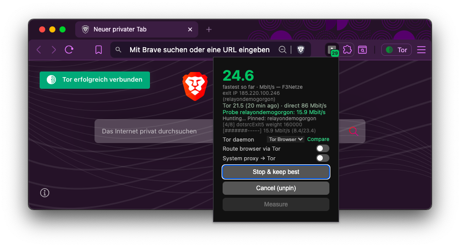

# torspeed

[](https://github.com/ikonnow/torspeed/actions/workflows/ci.yml)
[](https://github.com/ikonnow/torspeed/releases)
[](LICENSE)

**Find & pin the fastest Tor exit** — and **route your normal browser
through Tor with one switch** (fail-closed, no clearnet fallback).
Single binary, zero dependencies, everything local. Works with Brave Tor
windows, Tor Browser and system tor.



## Quick start

```sh
go install github.com/ikonnow/torspeed@latest   # or grab a binary from Releases
torspeed --install-ext                          # writes extension + native host
```

From source: `git clone https://github.com/ikonnow/torspeed && cd torspeed
&& make install` (build, test, install to `~/bin`).

Then: `brave://extensions` → **Developer mode** → **Load unpacked** →
pick `~/src/torspeed/extension` → enable **Allow in Incognito** (needed
for Tor windows). Click the toolbar icon — that's it. The extension's
native host auto-starts `torspeed --serve` (API + dashboard on
`127.0.0.1:8765`) whenever it isn't running; if no Tor daemon is found,
`--serve` spawns one automatically.

## Features

### Find fastest exit

`torspeed --hunt` or the **Find fastest exit** button: probes exit
candidates drawn at random from the top-60 exits — preferring **distinct
/24 subnets**, since the bandwidth-top pool concentrates a few operators
on shared uplinks — measures each on a fresh circuit, pins the winner
(`SETCONF ExitNodes`) and closes the stale circuits so open tabs switch
automatically — no reload needed. While `--serve` runs, measuring happens
on a **dedicated probe tor daemon** (spawned automatically, per-user data
dir `~/.torspeed/probe`), so the per-candidate re-pinning never touches
the browser's circuits — **your browsing is not interrupted** during a
hunt. The winner is applied gracefully: the new exit's circuit is warmed
up first, then old-exit circuits are swept — and a 10 s watcher keeps
sweeping late stragglers while a pin is active. Every 60 s it also
health-checks the pin: `ExitNodes` is strict, so a pinned relay that left
the consensus, lost `Running` or gained `BadExit` is **released**
automatically instead of leaving the browser without exit circuits.
Takes a few minutes;
**Stop & keep best** ends it early with the best found so far. A
`--target 15` value stops as soon as 15 Mbit/s is reached. Feeling slow
again later? Exits are shared — that's what the boost below is for.

### Keep improving (boost)

After a successful hunt torspeed keeps searching **in the background**
(on by default, toggle in the popup/dashboard or
`POST /api/boost?on=0|1`). While you surf, the probe daemon keeps
sampling exits: the pinned incumbent is re-tested regularly (it rots
too), promising contenders get a confirmation probe, and a contender only
replaces the pin when its confirmed mean is ≥15 % better — applied
gracefully, warm circuit first. Exits without potential or with expired
samples are dropped and cooled for 30 min.

Budget-friendly: ≤10 MB per probe, interval backs off 20 s → 5 min
(×1.5 per round), and boost stops itself after 60 min without an
improvement. It pauses while a hunt or measurement runs and stops on
unpin, abort or daemon switch. Status shows `boost_probes` /
`boost_switches`.

### Route browser via Tor

The headline switch: one toggle in the popup sends **all** browser
traffic through Tor — no Tor Browser / private window needed. It works
via a **fail-closed PAC script**:

- `SOCKS5` entries for every *ready* daemon, active one first; Chrome
  fails over to the next entry when a port dies.
- Loopback stays `DIRECT` (so the extension can reach the API); there is
  **no clearnet fallback** — unreachable Tor means pages fail, never leak.
- The background worker re-syncs every 30 s and on browser start — a
  Brave restart with a new dynamic Tor port, or Tor Browser
  starting/stopping, is picked up automatically. With no daemon
  reachable it falls back to the last known ports, then `9050` (the
  own-daemon port), still fail closed.
- WebRTC is set to `disable_non_proxied_udp` while routing is on.

**Caveat:** you get Tor's IP-level anonymity, **not** Tor Browser's
anti-fingerprinting — sites still see your normal browser fingerprint.
For fingerprint-sensitive use pick Tor Browser (port 9150/9151,
auto-discovered) or **Mullvad Browser** pointed at a spawned tor daemon
(SOCKS5 `127.0.0.1:9050` + remote DNS).

### System proxy → Tor

`--proxy` / `--noproxy`, or the popup/dashboard checkbox: sets the
system-wide SOCKS proxy (macOS `networksetup`, GNOME `gsettings`) so
proxy-aware apps go through Tor. Not a kernel VPN — apps that ignore
system proxy settings bypass it. While `--serve` runs it re-checks every
30 s and re-points a stale port to a ready daemon automatically.

### Compare daemons

`--compare` or the **Compare** link: measures all discovered daemons one
after another (sequential = fair on a shared downlink); the winner
becomes the active daemon.

### Live traffic, badge & hunt display

Popup and dashboard show live daemon throughput. While a hunt runs the
big number switches to the **fastest rate seen so far**: running probes
push it up live (green, pulses), and it settles back to each candidate's
true mean — so what you see at the end is what gets pinned; live traffic
shrinks to a small line. The toolbar badge follows the leading value
during a hunt and shows the last measured speed for up to 30 minutes
afterwards.

### Dashboard

`http://127.0.0.1:8765` — everything the popup does except browser
routing (needs the extension API), plus the full log.

## Popup guide

| Control | Does |
|---|---|
| Big number + caption | Live throughput · during a hunt: fastest score so far (green) |
| Exit-IP line | The IP the outside world sees via Tor right now — pinned exit, else the newest circuit's exit (resolved locally, no external IP check) |
| Result line | `Tor X (N min ago) · direct Y Mbit/s` — last measured vs baseline |
| Probe line | Current probe: `Probe NAME: x Mbit/s` |
| Status line | `Pinned: NAME` / `Random exit (not pinned)` / `Hunting…` / `offline` |
| Log line | Last server log message (hunt progress stays readable) |
| Tor daemon | Select the active daemon; ` (not ready)` marks dead ones; **Compare** races them |
| Route browser via Tor | Fail-closed browser routing (above); warns `No Tor daemon reachable` when it can't work |
| System proxy → Tor | System-wide SOCKS proxy for proxy-aware apps |
| Keep improving in background | Boost: keeps searching for a better exit after a hunt (probe counts show in the probe line) |
| Find fastest exit / Stop & keep best | Start a hunt / end it keeping the best |
| Unpin exit / Cancel (unpin) | Remove the pin / abort the hunt and unpin |
| Measure | One-shot speed test on the browser's real circuit — clearly below the pinned score → the circuit is re-rolled and re-measured (disabled while hunting) |

## CLI reference

| Flag | Default | Does |
|---|---|---|
| *(none)* | | One-shot speed test through the active daemon |
| `--hunt` | | Probe top exits, pin the winner |
| `--serve` | | Local API + dashboard + extension backend |
| `--port N` | `8765` | Port for `--serve` (the extension expects 8765) |
| `-w` | | Live throughput of the Tor daemon |
| `-c` | | Show active circuits + pinned exit |
| `--exit NAME` | | Pin a specific exit (name or fingerprint) |
| `--unpin` | | Remove exit pinning |
| `--open` | | Launch a browser with a Tor window |
| `--proxy` / `--noproxy` | | System SOCKS proxy on/off |
| `--compare` | | Measure all daemons sequentially, activate winner |
| `--start-tor` | | Spawn the own tor daemon (needs `tor` in PATH) |
| `--install-ext` | | Write extension files + native host manifest |
| `--target M` | `0` | Hunt: stop as soon as ≥M Mbit/s is reached |
| `--candidates N` | `8` | Candidates per hunt (random from the top-60 pool) |
| `--samples N` | `2` | Measurements per candidate, averaged, fresh circuit each |
| `-u URL` | | Extra test URL, tried first |
| `--maxmb N` | `20` | Byte budget per speed test |
| `--version` | | Print version and exit |

## How it works

- **Discovery:** ControlPort via Brave's `tor/watch/controlport`, else
  9151 (Tor Browser) / 9051 (system tor), else the spawned daemon.
  Authenticates via `PROTOCOLINFO` + cookie. `--serve` additionally
  resolves each daemon's SOCKS port and readiness
  (`status/circuit-established`).
- **Candidates:** random draw from the top-60 `Exit`+`Running` relays
  whose exit policy covers ports 80 **and** 443; `BadExit` relays are
  skipped and missing policies are resolved lazily via `md/id`.
- **Measurement:** up to 3 parallel download streams over SOCKS5 (a single
  Tor stream is window-limited; browsers use many). Each sample gets a
  random SOCKS username → `IsolateSOCKSAuth` builds a **fresh circuit**
  with a random middle relay. The score is **steady-state** throughput —
  circuit build, TLS, TTFB and congestion-control slow start are
  excluded — averaged over the samples. Once a URL delivers data it is
  reused for later samples; two consecutive failures fall back to the
  full list. Slow samples are aborted early (well below the current
  best) and converged rates stop the download.
- **Conflux:** tor 0.4.8+ builds linked circuit pairs — every sample's
  circuits are verified against the pinned candidate afterwards (a stale
  conflux set can otherwise carry the previous exit) and always closed
  again, so samples never leak onto the wrong exit or linger around.
- **Probe daemon:** `--serve` spawns a second, private tor
  (`~/.torspeed/probe`, auto ports) that does all candidate measuring —
  `SETCONF ExitNodes` there never abandons the browser's circuits.
- **Pinning:** `SETCONF ExitNodes=$FP` — transient, resets on Tor
  restart. The new exit is warmed with a no-auth connect (same isolation
  class as the browser's PAC traffic), *then* every `BUILT`
  general-purpose circuit whose last hop is not the winner gets
  `CLOSECIRCUIT`, so even keep-alive/HTTP/2 connections move to the
  pinned exit immediately — no reload, no `NEWNYM`. A 10 s watcher
  sweeps late conflux stragglers while a pin is active.
- **Baseline:** a short direct (non-Tor) probe runs once at first status
  poll and after every hunt/measure — that's the `direct Y Mbit/s`
  reference. It is throttled (≥10 min apart) and never overlaps a hunt.

## Privacy & trade-offs

- Pinning concentrates all your exits on one relay — more speed, less
  diversity. `--unpin` anytime; Tor restarts also clear it.
- A hunt downloads up to `candidates × samples × maxmb` (default
  8×2×20 MB ≈ 320 MB) plus a small verification probe; early stops and
  convergence usually cut this well below half.
- Fail-closed everywhere: browser routing never falls back to direct,
  and the system proxy is only re-pointed to a *ready* daemon.
- All traffic during measurement goes through Tor; only the test file
  downloads (DNS resolved by the exit).

## Updating

Re-run `torspeed --install-ext` and reload the extension in
`brave://extensions` — v0.6 adds the boost toggle (`/api/boost`); older
popups keep working, they just don't show the switch.

## Development

```sh
make            # gofmt check + vet + go test -race + jscheck + jstest + build
make test       # hermetic Go tests (no Tor daemon or network needed)
make jscheck    # node --check on extension/*.js
make jstest     # node --test on jstest/ (bg.js PAC logic, mocked chrome.*)
make release    # cross-compile macOS/Linux/Windows binaries
```

`go build -o torspeed .` works directly — `make` just gates on the
checks first.

## Troubleshooting

- **Popup says `offline`:** the API isn't reachable — the native host
  should auto-start `--serve`; check `curl http://127.0.0.1:8765/api/status`.
- **Extension won't load:** `brave://extensions` shows the card error;
  re-run `--install-ext` so manifest and files match the binary version.
- **`No Tor daemon reachable`:** browser routing is on but no ready
  daemon was found — start one (`torspeed --start-tor`) or open a Tor
  window.
- **Raw API:** `curl -X POST http://127.0.0.1:8765/api/measure`,
  `/api/hunt`, `/api/stop`, `/api/unpin`, `/api/compare`.

## Platforms

macOS / Linux / Windows (static binaries). Android: Termux +
`pkg install tor` works fully; Orbot = measure only. On Tor Browser use
the dashboard — extensions are discouraged there.
